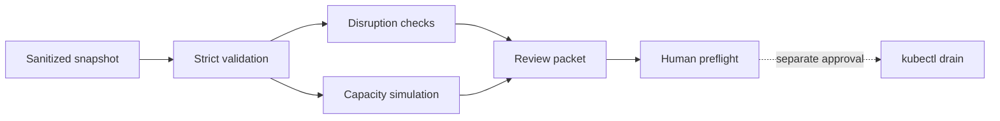

# DrainScope — Kubernetes Eviction Readiness Analyzer

DrainScope is an offline portfolio demonstration that turns a **sanitized Kubernetes node-maintenance snapshot** into an explainable drain review packet. It models disruption budgets, replacement capacity, controller health, topology spread, local-storage exposure, critical pods, DaemonSets, static pods and unmanaged workloads before an operator runs any cluster command.

This is newly authored portfolio code, not employer tooling, production evidence or a claim of global novelty. It never contacts Kubernetes and `drain_authorized` is always `false`.

## Why this project exists

`kubectl drain --dry-run` is useful, but safe maintenance also depends on current PDB budgets, whether replicas are already degraded, where replacements can schedule, and whether a drain concentrates a service into one zone. DrainScope makes those assumptions reviewable without storing a complete cluster dump.



## Run locally

Python 3.11+; standard library only.

```bash
python -m unittest -v
python drainscope.py samples/ready.json --at 2026-10-19T09:30:00Z
python drainscope.py samples/blocked.json --at 2026-10-19T09:30:00Z
```

The ready synthetic scenario exits `0` with `ready_for_human_review`; the blocked scenario exits `1` with explicit findings. Invalid evidence exits `2`. `--at` exists for deterministic sample replay. In a maintenance pipeline, omit it and use a freshly collected timestamp.

## Fixed checks

| Condition | Finding | Result |
|---|---|---|
| Snapshot older than 300 seconds | `SNAPSHOT_STALE` | Hold |
| Pod has no recreating owner | `UNMANAGED_POD` | Hold |
| Mirror/static pod is present | `STATIC_POD` | Hold |
| Critical workload is present | `CRITICAL_POD` | Hold for explicit review |
| Controller is below desired readiness | `CONTROLLER_DEGRADED` | Hold |
| `hostPath`, local PV or unbounded `emptyDir` | `LOCAL_STORAGE_RISK` | Hold |
| Evictions exceed shared PDB budget | `PDB_BUDGET_EXCEEDED` | Hold |
| No eligible ready/schedulable node | `NO_ELIGIBLE_NODE` | Hold |
| Conservative CPU/memory placement fails | `INSUFFICIENT_REPLACEMENT_CAPACITY` | Hold |
| Multi-replica service cannot retain two zones | `TOPOLOGY_CONCENTRATION` | Hold |

DaemonSet and terminal pods are recorded as notes and excluded from replacement placement. Policy is intentionally code-reviewed; an input snapshot cannot lower it.

## Snapshot contract and privacy

The samples define schema `1.0`. A collector should export only the fields needed here: sanitized node/pod identities, owner/controller state, PDB allowance, requests, eligible nodes, zones and local-volume type. Do **not** include Secrets, ConfigMap contents, environment variables, annotations, image pull credentials, account identifiers or employer/customer data. Private snapshots and generated packets are ignored by the included `.gitignore`.

The output includes a SHA-256 fingerprint of the complete parsed snapshot so an operator can detect evidence mismatches. That fingerprint is not a signature and does not establish who collected the data.

## Security and operational limits

- Replacement placement is deterministic, constrained first-fit-decreasing over requested CPU and memory. It is conservative but is **not** the kube-scheduler.
- It does not model every affinity expression, taint, device, CSI behavior, admission policy, autoscaler action, surge replica or PDB race.
- `eligible_nodes` must come from a trusted collector that evaluates selectors, taints/tolerations and affinity. The analyzer filters out nodes recorded as unready or unschedulable.
- Evidence can change immediately after collection. Run a fresh live preflight, inspect events and obtain human approval before maintenance.
- There is no cluster access, eviction API call, cordon, drain, rollback or automatic remediation.

## Validation status

Eighteen automated tests cover healthy and blocked decisions, evidence freshness, controllers, PDB aggregation, local storage, topology, capacity, DaemonSets, static/terminal/unmanaged pods, strict JSON parsing, output safety and CLI exit codes. Both synthetic scenarios and Python compilation are run locally and in portfolio CI. No real cluster, kubeconfig, cloud account or drain was used.

See [RUNBOOK.md](RUNBOOK.md) for collection, review, hold handling and cleanup guidance.
