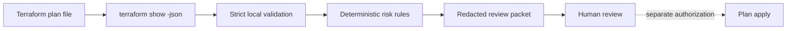

# Terraform Change Sentinel

An offline portfolio demonstration that converts `terraform show -json` output into a **redacted, explainable review packet**. It highlights destructive replacements, privilege changes, public network exposure, weakened S3 public-access controls, unsafe AKS control-plane settings and oversized change sets before a human decides whether work may proceed.

This is newly authored portfolio code, not employer tooling, a compliance certification, production deployment evidence or a claim of global novelty. It never runs Terraform, cloud commands or remediation.

## Why this project exists

Plain-text plan review can bury high-impact changes inside provider output, while exporting the complete JSON plan can expose sensitive values. Change Sentinel keeps the useful control evidence—resource address, type, action, finding code and plan fingerprint—without emitting `before`, `after`, `planned_values` or marked-sensitive values.



The final apply is intentionally outside this project. `execution_authorized` is always `false`, including when the decision is `ready_for_human_review`.

## Run locally

Requires Python 3.11+ and only the standard library.

```bash
python -m unittest -v
python changesentry.py samples/safe-plan.json
python changesentry.py samples/risky-plan.json
```

The safe synthetic scenario exits `0` with `ready_for_human_review`. The risky scenario exits `1` with a hold for public SSH exposure, an IAM-policy change and a database replacement. Invalid or unsupported input exits `2` without echoing input values or paths.

For an authorized Terraform workspace, generate plan data in a protected temporary directory:

```bash
terraform plan -out=local.tfplan
terraform show -json local.tfplan > plan.private.json
python changesentry.py plan.private.json > review-packet.json
```

Terraform plan JSON can contain cleartext secrets even when fields are marked sensitive. Do not commit, upload, paste into tickets, or retain `local.tfplan` or `plan.private.json`. Use a restricted runner and artifact policy. This repository's `.gitignore` excludes common local names, but ignore rules are not a security boundary. Review the redacted packet before sharing it.

## Decision rules

| Condition | Finding | Result |
|---|---|---|
| Delete or replace action | `RESOURCE_DELETION` / `RESOURCE_REPLACEMENT` | Hold |
| IAM, KMS, cloud-role or Kubernetes cluster-role change | `PRIVILEGE_CHANGE` | Hold |
| Public CIDR/wildcard in supported firewall resources | `PUBLIC_NETWORK_EXPOSURE` | Hold |
| Any S3 public-access-block control not explicitly true | `S3_PUBLIC_GUARD_WEAKENED` | Hold |
| AKS private API or local-account setting unsafe/absent | `AKS_PUBLIC_CONTROL_PLANE` / `AKS_LOCAL_ACCOUNTS_ENABLED` | Hold |
| Resource count above `--max-changes` (default 200) | `CHANGE_LIMIT_EXCEEDED` | Hold |
| Only recognized create/update/read/no-op changes without findings | none | Ready for human review |

Rules are deliberately fixed in reviewed code; an input document cannot lower the policy. Supported Terraform JSON format versions must begin with `1.`. Unknown or impossible action sequences fail closed. Inputs are capped at 5 MB and 1,000 resource changes; the output is deterministic for the same logical JSON input.

## Trust boundaries and limitations

- The SHA-256 fingerprint binds the complete parsed plan to the packet. It detects mismatches; it is not a signature and does not prove who created the plan.
- The analyzer reads the plan locally to evaluate selected `after` fields but never includes those values in output. Resource addresses can still reveal architecture and should be handled as internal metadata.
- Public-network detection is limited to recognized AWS, Azure and GCP firewall resource types and literal world-routable CIDRs/wildcards. It does not model route tables, load balancers, inherited policies, modules, provider defaults, IPv6 ranges beyond `::/0`, or organization guardrails.
- Privilege detection is resource-type based. It does not parse IAM policy semantics, Kubernetes manifests embedded in strings, or every provider's authorization resources.
- Replacement and deletion always hold, even when intentional. The tool has no bypass flag; the owner documents migration, rollback, backup and approval outside this CLI.
- A reviewable packet is not proof of a safe plan, successful deployment, drift-free state, policy compliance or reviewer approval.

## Validation status

Seventeen automated tests cover safe and risky scenarios, deletion/replacement ordering, privilege patterns, public CIDRs, S3 and AKS controls, limits, fingerprints, strict JSON parsing, redaction and CLI exit behavior. Both sample scenarios and Python compilation were run locally. No real Terraform plan, provider, cloud account, CI apply, policy engine or production system was used.

See [RUNBOOK.md](RUNBOOK.md) for the reviewer workflow, hold handling and cleanup. Future extensions could add signed plan provenance, reviewed provider-specific rule packs, OPA comparison tests and pull-request annotations that still preserve the no-apply boundary.
